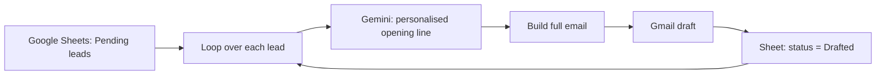

# AI Cold Email Personalizer

An n8n automation that turns a list of leads into **personalised cold emails**. For each prospect, Google Gemini writes a natural opening line from a short note about their online store, and the full email is saved as a **Gmail draft**, ready to review and send.

**Stack:** n8n (self-hosted) · Google Gemini · Google Sheets API · Gmail API

<!-- Add a screenshot of the workflow canvas here:  -->

## The problem

Generic cold emails get ignored. Personalised ones work, but writing a custom first sentence for every prospect by hand doesn't scale.

## What it does

- Reads every lead with status `Pending` from a Google Sheet
- Turns a quick raw note (e.g. *"the personalised jewellery concept"*) into a fluent, human-sounding opening line
- Builds the full email from a template (first name, opening line, pitch, signature)
- Saves it as a Gmail draft addressed to the prospect
- Marks the lead as `Drafted` in the sheet, so it is never processed twice

## How it works

## Example

| Raw note in the sheet | Opening line written by the AI |
|---|---|
| the personalised jewellery concept | I was looking at your website earlier (great work, your personalised jewellery concept is a brilliant idea!) and it got me thinking about how much work your customer support must be. |
| i love how they help local fishermen | I was looking at your website earlier (great work, I particularly like how you support local fishermen!) and it got me thinking about how much work your customer support must be. |

The model is guided with a fixed sentence structure and a few examples (few-shot prompting), so the output stays consistent while adapting the grammar to each note.

## Setup

1. **Import** [`workflows/cold-email-personalizer.json`](workflows/cold-email-personalizer.json): in n8n, go to *Workflows > Import from File*.
2. **Connect your accounts**: Google Sheets, Gmail and Google Gemini (free API key from [Google AI Studio](https://aistudio.google.com/)).
3. **Create the lead sheet** with the headers from [`examples/leads-template.csv`](examples/leads-template.csv) and select it in the *Get Pending Leads* and *Mark as Drafted* nodes.
4. **Edit the template** in the *Build Email* node: your pitch, name and phone number.
5. Add leads with status `Pending`, then click **Execute workflow**.

## Design choices

- **Drafts, not automatic sending**: every email can be checked before it leaves, which protects the sender's reputation.
- **Few-shot prompt with a fixed structure**: the AI only writes the part that needs personalisation; the rest of the email stays under the sender's control.
- **Status column**: makes the workflow safe to run again at any time.

## Author

Built by Nathanaël. <!-- Add your LinkedIn / contact link here -->
