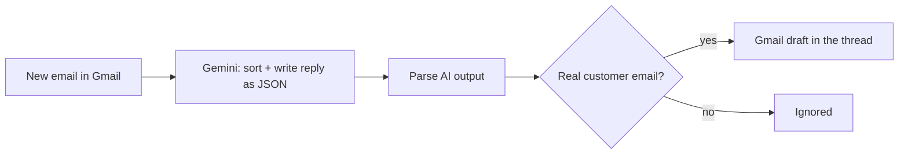

# AI Customer Support Assistant for E-commerce

An n8n automation that reads incoming customer emails, understands what the customer needs and prepares a ready-to-send **reply draft in Gmail**, in the customer's language and the brand's tone.

A human stays in the loop: the AI only writes drafts, nothing is sent without being reviewed.

**Stack:** n8n (self-hosted) · Google Gemini · Gmail API · Google Sheets API · JavaScript


## The problem

Small e-commerce brands answer the same questions all day long: *"Where is my order?"*, *"How do I return this item?"*, *"Which size should I take?"*. Each answer is easy, but together they eat hours and constantly break the team's focus.

## What it does

- Watches the support inbox (checks for new emails every minute)
- Sorts each email: order tracking, return/refund, product question, other, or spam
- Writes a reply using **only the store's own knowledge base** (no invented prices, delays or policies)
- When information is missing, it writes `[TO COMPLETE: ...]` instead of guessing, and flags the email
- Skips spam, newsletters and automated notifications
- Saves the reply as a Gmail draft **in the original conversation thread**

## How it works



## The three versions

| Workflow | What it adds |
|---|---|
| [`01-basic-draft-replies.json`](workflows/01-basic-draft-replies.json) | The core assistant: sorting + draft reply |
| [`02-pdf-attachment-reader.json`](workflows/02-pdf-attachment-reader.json) | Reads PDF attachments (invoices, order confirmations) and uses them in the reply |
| [`03-crm-logging-google-sheets.json`](workflows/03-crm-logging-google-sheets.json) | Also extracts the customer's details and logs every request in Google Sheets |

## Example

*Illustrative example of the expected behaviour.*

> **Customer email:** "Hi, I ordered a linen shirt last week and I still haven't received anything. Can you help? Julie"

The AI returns:

```json
{
  "category": "order_tracking",
  "urgency": "medium",
  "missing_info": false,
  "reply": "Hello Julie,\n\nThank you for your message, and sorry for the wait! Could you send us your order number (e.g. #1234)? In the meantime, you can follow your parcel here: [tracking page]...\n\nBest regards,\nThe [Store] team"
}
```

The reply then appears as a draft under Julie's email, ready to be checked and sent.

## Setup

1. **Import** the workflow: in n8n, go to *Workflows > Import from File*.
2. **Connect your accounts**: Gmail (OAuth2) and Google Gemini (free API key from [Google AI Studio](https://aistudio.google.com/)). Version 03 also needs Google Sheets.
3. **Fill in the knowledge base**: open the *Draft Reply (AI)* node and replace every `[BRACKETED]` value with the store's real information (shipping times, return policy, links...).
4. **Version 03 only**: create a Google Sheet whose first row contains the headers from [`examples/support-log-template.csv`](examples/support-log-template.csv), then select it in the *Log to Google Sheets* node.
5. **Test**: click *Execute workflow*, send yourself an email, check the draft. Then activate the workflow.

## Design choices

- **Human in the loop**: drafts instead of automatic sending, so a wrong answer never reaches a customer.
- **Grounded answers**: the AI may only use the knowledge base; anything else becomes a visible `[TO COMPLETE]` gap.
- **Structured output**: one AI call returns JSON (category, urgency, reply, and customer data in version 03), which keeps the workflow simple and cheap.
- **Fail-safe parsing**: if the AI returns invalid JSON, a draft asking for a manual answer is created, so no customer email is ever lost.

## Limitations and next steps

- Only the first attachment is read, and only if it is a PDF.
- Gmail only (could be adapted to Outlook or IMAP).
- Ideas: look up orders in Shopify to answer tracking questions automatically, apply Gmail labels by urgency, send a Slack alert for urgent emails.

## Author

Built by Nathanaël. <!-- Add your LinkedIn / contact link here -->
